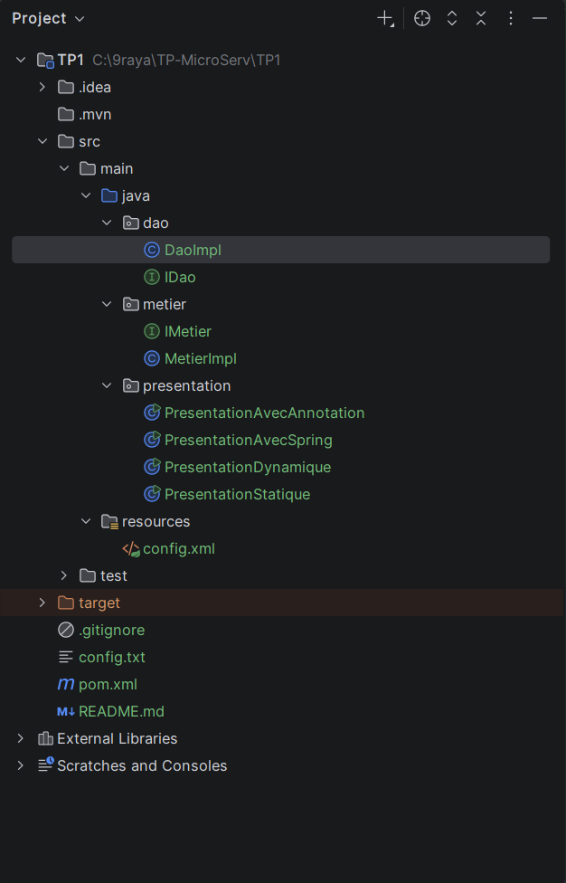
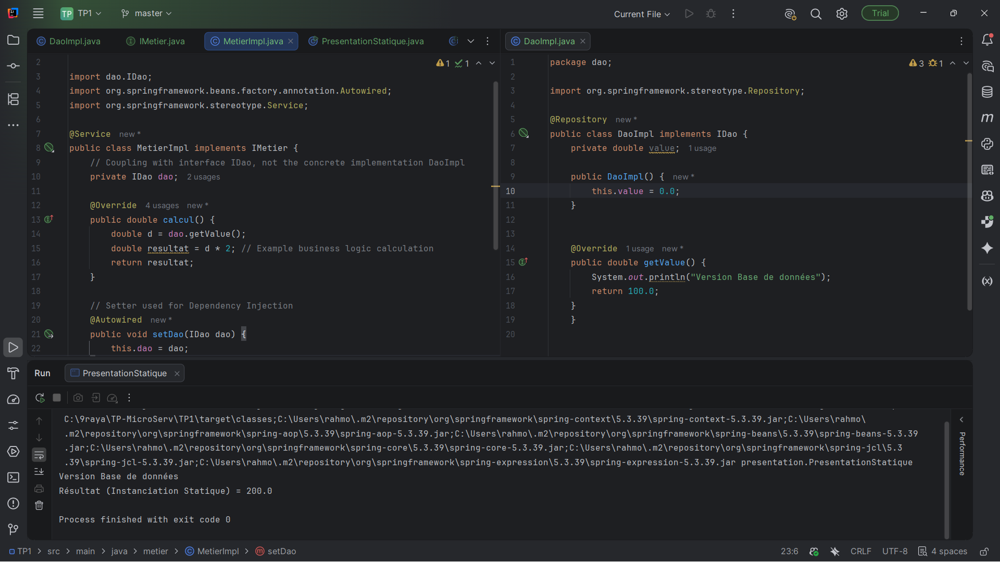
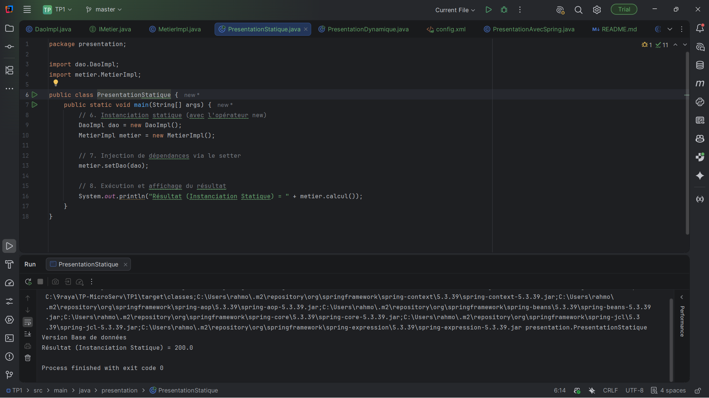
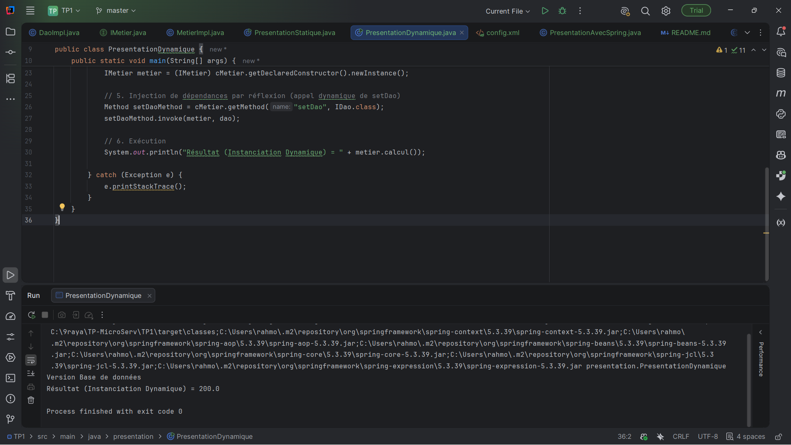
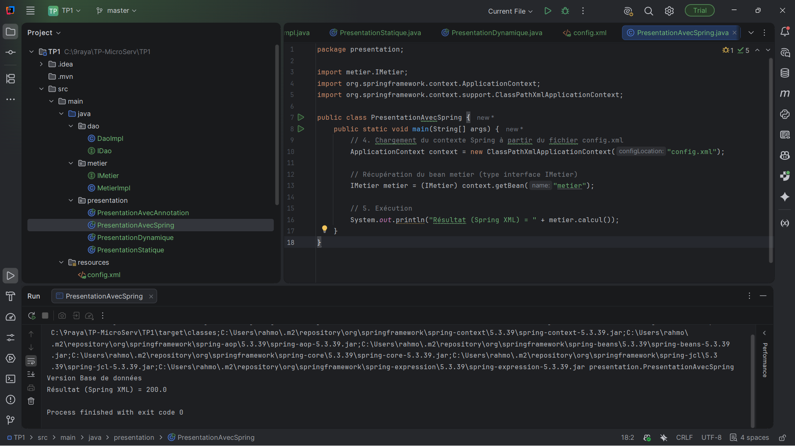
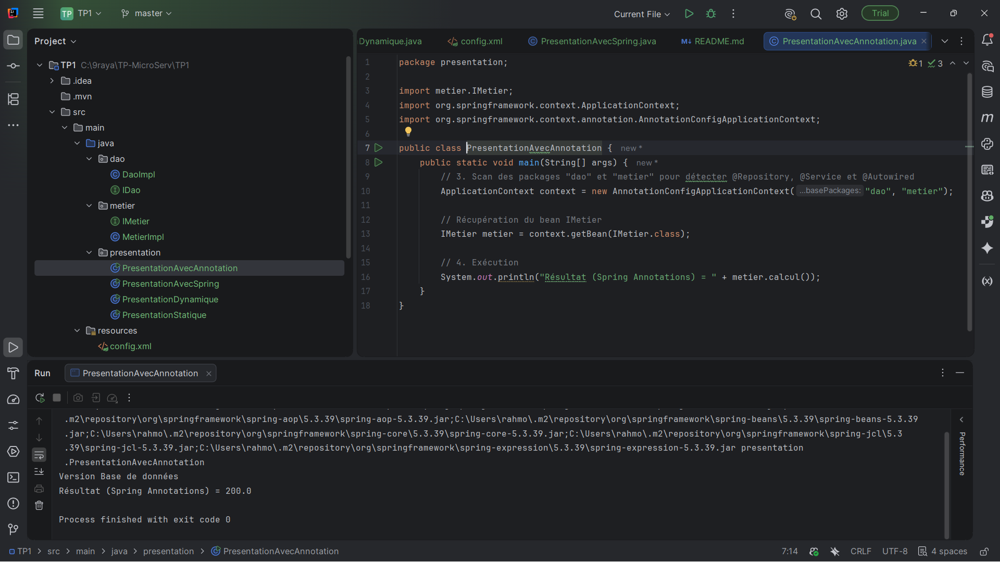

# TP1 : Inversion de Contrôle (IoC) et Injection de Dépendances (DI)

---

## 1. Objectifs du TP
Ce travail pratique a pour objectif de :
* Comprendre et mettre en œuvre le principe de **couplage faible** entre les composants logiciels.
* Maîtriser les concepts d'**Injection de Dépendances (DI)** et d'**Inversion de Contrôle (IoC)**.
* Passer progressivement d'une instanciation statique (`new`) à une instanciation dynamique par réflexion (`Class.forName`), puis à l'utilisation du conteneur léger **Spring Framework** (configuration XML et annotations).

---

## 2. Architecture et Structure du Projet

L'application respecte une architecture en couches séparant l'accès aux données (`dao`), la logique métier (`metier`) et la couche de présentation (`presentation`).

*Figure 1 : Arborescence globale du projet Maven `TP1` sous IntelliJ IDEA (packages `dao`, `metier`, `presentation`, fichier `config.txt`, fichier `config.xml` et `pom.xml`).*

*Figure 2 : Implémentation des interfaces `IDao` / `IMetier` et des classes `DaoIMP` / `MetierIMP` illustrant l'association via l'interface `IDao`.*

---

## 3. Activité 1-1 : Injection de dépendances par instanciation statique

### Exécution et Résultat
Dans cette première activité, la classe `PresentationStatique` instancie directement `DaoIMP` et `MetierIMP` avec l'opérateur `new`, puis injecte l'objet `dao` dans `metier` via le setter `metier.setDao(dao)`.

*Figure 3 : Code source et résultat d'exécution de la classe `PresentationStatique` dans la console IntelliJ IDEA.*

### Réponses aux questions (Activité 1-1)

**9. Expliquez comment cela illustre le couplage faible.**
Le couplage faible est illustré au niveau de la classe `MetierIMP` car celle-ci dépend uniquement de l'interface `IDao` (`private IDao dao;`) et non de la classe concrète `DaoIMP`. Ainsi, on peut remplacer `DaoIMP` par n'importe quelle autre implémentation de `IDao` (par exemple `DaoIMP2` pour un capteur ou un service web) sans modifier une seule ligne de code dans la classe `MetierIMP`. `MetierIMP` est donc fermée à la modification et ouverte à l'extension.

**10. Le principe d'Inversion de Contrôle est-il respecté ? Justifier.**
* **Partiellement (au niveau de `MetierIMP`) :** Oui, car `MetierIMP` ne crée pas elle-même son objet `IDao` (elle délègue cette création à l'extérieur et reçoit la dépendance via `setDao()`).
* **Globalement (au niveau de l'application) :** Non, le principe d'IoC n'est pas totalement respecté car c'est le code de l'application lui-même (la classe `PresentationStatique`) qui contrôle explicitement le cycle de vie et la création des objets avec `new DaoIMP()` et `new MetierIMP()`, ce qui crée un **couplage fort** dans `PresentationStatique`.

**11. Que faudrait-il modifier pour éviter que la classe de présentation contrôle directement la création des objets ?**
Il faut supprimer l'utilisation de l'opérateur `new` des classes concrètes dans la couche de présentation et externaliser les noms des classes à instancier dans un fichier de configuration externe (ex: `.txt`, `.xml`), puis utiliser l'instanciation dynamique par réflexion (`Class.forName()`) ou déléguer totalement la création et l'assemblage des objets à un conteneur d'Inversion de Contrôle comme **Spring**.

---

## 4. Activité 1-2 : Injection de dépendances par instanciation dynamique

### Exécution et Résultat
Dans cette activité, les noms des classes concrètes (`dao.DaoIMP` et `metier.MetierIMP`) sont lus depuis le fichier `config.txt` et chargés dynamiquement en mémoire via l'API de réflexion Java (`Class.forName()`).

*Figure 4 : Contenu du fichier `config.txt`, code de `PresentationDynamique` utilisant `Class.forName`, et résultat d'exécution.*

### Réponses aux questions (Activité 1-2)

**7. Expliquez comment cela illustre l'injection de dépendances par instanciation dynamique.**
La classe `PresentationDynamique` ne mentionne aucune classe concrète (`DaoIMP` ou `MetierIMP`) dans son code source ; elle ne manipule que les interfaces `IDao` et `IMetier`. Au moment de l'exécution (runtime), elle lit les noms des classes depuis `config.txt`, les charge dynamiquement avec `Class.forName()`, les instancie avec `getDeclaredConstructor().newInstance()`, et invoque dynamiquement la méthode `setDao` via `Method.invoke(metier, dao)` pour injecter la dépendance.

**8. En quoi cette approche se rapproche-t-elle davantage du principe IoC que l'activité 1-1 ?**
Contrairement à l'activité 1-1 où le choix des implémentations était figé dans le code Java (nécessitant une recompilation en cas de changement), le contrôle du choix des implémentations est ici inversé et déporté vers un fichier de configuration externe (`config.txt`). On peut changer l'implémentation de la couche DAO ou Métier simplement en modifiant le fichier texte, sans recompiler l'application.

**9. Quels sont les avantages et les limites de cette solution ?**
* **Avantages :**
  * Découplage total du code source vis-à-vis des classes concrètes.
  * Évolutivité : changement d'implémentation à chaud via `config.txt` sans recompilation.
* **Limites :**
  * Le développeur doit toujours écrire manuellement le code technique de lecture du fichier, d'instanciation par réflexion et d'invocation des setters (code répétitif et verbeux).
  * Gestion complexe si l'application comporte des dizaines de classes avec un graphe de dépendances profond.
  * Absence de vérification à la compilation (risque de `ClassNotFoundException`, `NoSuchMethodException` à l'exécution) et absence de gestion avancée du cycle de vie des objets (scopes Singleton/Prototype, etc.).

---

## 5. Activité 1-3 : Injection de dépendances avec Spring (Configuration XML)

### Exécution et Résultat
Le fichier `config.xml` déclare les beans `dao` et `metier` ainsi que leur liaison (`<property name="dao" ref="dao"/>`). La classe `PresentationAvecSpring` démarre le conteneur Spring via `ClassPathXmlApplicationContext`.

*Figure 5 : Configuration des beans dans `config.xml` et exécution de la classe `PresentationAvecSpring`.*

### Réponses aux questions (Activité 1-3)

**6. Comparer cette solution avec l'activité 1-2 en termes de gestion des dépendances.**
Dans l'activité 1-2, le développeur devait coder lui-même la mécanique de réflexion (`Scanner`, `Class.forName`, `getMethod`, `invoke`) et gérer l'ordre d'instanciation. Avec Spring XML (Activité 1-3), toute cette plomberie technique est automatisée par le conteneur IoC de Spring (`ApplicationContext`). Le développeur déclare simplement la structure des dépendances de manière déclarative dans `config.xml`, et Spring se charge d'instancier les beans dans le bon ordre et d'injecter les dépendances automatiquement.

**7. Expliquer la différence entre : création manuelle des objets / création par réflexion (`Class.forName`) / création par le conteneur Spring.**

| Mode de création | Principe de fonctionnement | Niveau de couplage & Maintenance |
| :--- | :--- | :--- |
| **Création manuelle (`new`)** | Le code applicatif instancie directement les classes concrètes à la compilation. | **Couplage fort** : toute modification d'implémentation impose de modifier le code source et de recompiler. |
| **Création par réflexion (`Class.forName`)** | Le code applicatif lit le nom des classes depuis un fichier et utilise l'API Reflection pour instancier et lier les objets au runtime. | **Couplage faible**, mais **coût de maintenance élevé** : le développeur doit gérer manuellement les exceptions, l'ordre de création et l'appel des méthodes par réflexion. |
| **Création par le conteneur Spring** | Le framework IoC prend entièrement en charge l'instanciation, la gestion du cycle de vie (Singleton, etc.) et l'injection des dépendances. | **Couplage faible et haute maintenabilité** : le code métier reste propre et l'assemblage est délégué au conteneur. |

---

## 6. Activité 1-4 : Injection de dépendances avec Spring (Annotations)

### Exécution et Résultat
Les classes `DaoIMP` et `MetierIMP` sont annotées respectivement avec `@Repository` et `@Service`, et la dépendance est injectée via `@Autowired`. La classe `PresentationAvecAnnotation` utilise `AnnotationConfigApplicationContext("dao", "metier")` pour scanner les packages.

*Figure 6 : Utilisation des annotations `@Repository`, `@Service`, `@Autowired` et exécution de `PresentationAvecAnnotation`.*

### Réponses aux questions (Activité 1-4)

**5. Expliquez comment Spring gère l'injection de dépendances à l'aide des annotations.**
1. Au démarrage, `AnnotationConfigApplicationContext("dao", "metier")` effectue un **Component Scanning** (balayage des packages indiqués).
2. Il détecte toutes les classes annotées avec des stéréotypes Spring (`@Component`, `@Repository` sur `DaoIMP`, `@Service` sur `MetierIMP`) et les instancie automatiquement sous forme de **Beans Spring** dans son conteneur.
3. Lorsqu'il rencontre l'annotation `@Autowired` (sur l'attribut `dao`, le constructeur ou le setter de `MetierIMP`), Spring recherche dans son contexte un bean compatible avec le type `IDao` (ici l'instance de `DaoIMP`) et l'injecte automatiquement dans `MetierIMP`.

**6. Pourquoi cette solution est-elle plus maintenable que la configuration XML ?**
* **Concision et lisibilité :** Elle élimine les fichiers XML longs et verbeux qui deviennent difficiles à maintenir lorsque le projet grandit.
* **Proximité de la configuration :** Les métadonnées de configuration (`@Service`, `@Repository`, `@Autowired`) sont placées directement dans le code Java des classes concernées, ce qui facilite la compréhension et le refactoring dans l'IDE.
* **Détection automatique :** L'ajout d'une nouvelle classe annotée dans un package scanné suffit pour qu'elle soit prise en compte par Spring sans avoir à éditer un fichier central `config.xml`.

**7. En quoi cette activité représente-t-elle une application complète du principe IoC ?**
Cette activité applique intégralement le principe d'Inversion de Contrôle (le *Principe d'Hollywood : "Ne nous appelez pas, c'est nous qui vous appellerons"*) : aucune classe de l'application (`DaoIMP`, `MetierIMP`, ni `PresentationAvecAnnotation`) n'instancie ses dépendances ni ne gère manuellement la réflexion ou le câblage. C'est le conteneur Spring qui prend le contrôle total du cycle de vie des composants (découverte par scan, instanciation, résolution et injection automatique des dépendances) et fournit à l'application un composant `IMetier` prêt à l'emploi.